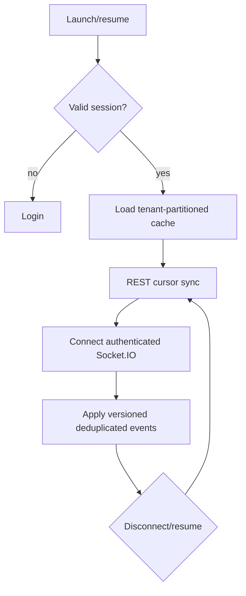

# Android application architecture

## Principles

The Expo/React Native application is another client of the same NestJS API. PostgreSQL remains authoritative; Android gets no separate business database, Prisma access, provider tokens, or duplicated authorization/business rules. Local storage is only a disposable, tenant-partitioned cache and offline UI aid.

## Modules and screens

- Authentication: login/logout, session refresh, organization selection, future MFA/step-up.
- Inbox: All/DM/Comments tabs, filters, cursor pagination, unread/offline states.
- Thread: conversation or comment timeline, customer/channel context, actual reply author, current assignee, status.
- Composer: capability-aware text/attachments, idempotent submit, progress/error/retry.
- Actions: read/unread, resolve/reopen, and assignment controls only when server permissions allow.
- Notifications/settings: device registration, preferences, secure logout, diagnostics without sensitive content.

Use established Expo-compatible navigation and data-fetching libraries selected/pinned in Milestones 2 and 15. Accessibility, large text, screen readers, touch targets, and slow/unstable network behavior are acceptance concerns.

## Shared code

`packages/contracts` supplies runtime schemas and transport types. `packages/api-client` supplies authenticated requests, refresh coordination, cursor pagination, idempotency keys, uploads, version/error handling, and sync endpoints. It accepts platform-specific token storage/network lifecycle adapters rather than importing browser/native globals directly.

Do not share server authorization, Prisma models, provider SDKs, or secrets. UI code is native-specific unless a demonstrated abstraction is genuinely reusable.

## Mobile authentication

- Store refresh/session secret in Expo SecureStore backed by Android Keystore capabilities; never AsyncStorage or source code.
- Keep access credentials in memory where practical; serialize refresh so concurrent `401` responses do not rotate the same token repeatedly.
- Clear credentials, tenant caches, socket subscriptions, temporary uploads, and notification registration as appropriate on logout/account removal.
- Validate TLS normally; no production cleartext traffic or disabled certificate checks. Certificate pinning is a later threat/operations decision, not assumed automatically.
- App links/deep links carry opaque navigation references, never bearer tokens; navigation re-authorizes fetched resources.

## Synchronization and offline behavior

- Cache summaries/timelines by organization and resource with an explicit schema version; encrypt highly sensitive local data if retained, and minimize content.
- Offline mode is read-only by default for risky mutations. A later approved outbox may queue safe commands with idempotency keys and clear user-visible pending state; it must revalidate permissions/capabilities when online.
- Reconnect uses exponential backoff with network/app-state awareness, then REST cursor sync before treating socket data as current.
- Optimistic replies have client-generated IDs and reconcile with HTTP/socket results without duplication. Failed or capability-expired sends remain visible and actionable.
- Background execution is not assumed. Push notifications prompt a fresh authorized sync; foreground Socket.IO provides live updates.

## Push architecture

Milestone 17 selects Expo Push Service or direct FCM based on requirements. The app obtains a platform token and registers it through the API with device/app/environment metadata. Server stores a protected fingerprint/token record, respects preferences, removes invalid tokens, and sends minimal non-sensitive notification text by default. Tapping a notification authenticates and refetches the referenced resource; payload ownership is never trusted.

## Build and environment separation

Development, preview/staging, and production builds use distinct application identifiers where appropriate, API origins, signing credentials, notification projects, and deep-link domains. Public Expo configuration contains only non-secret client settings. EAS/Play signing keys remain in approved secret stores. Physical-device testing is required before Milestones 17/19 completion.

## Testing

Unit-test reducers/sync/deduplication and SecureStore adapters; contract-test the shared client; component-test permissions/offline/error views; navigation-test tenant switching/deep links; integration-test refresh/revocation/uploads; and device-test reconnect/background/push. Cross-tenant cache leakage and screenshots/notification content are explicit security cases.

