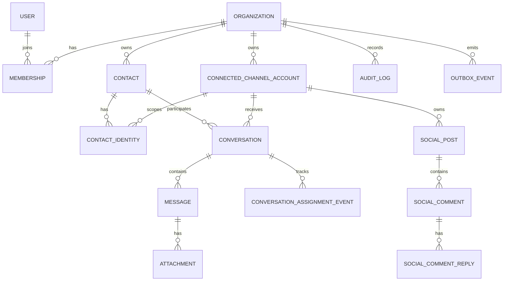

# Database design

## Conventions

- PostgreSQL is authoritative. Use UUID primary keys generated server-side/database-side; provider IDs remain strings.
- Tenant-owned tables include non-null `organization_id` and indexes beginning with it for tenant queries.
- Store timestamps as timezone-aware UTC (`timestamptz`), with `created_at` and `updated_at` where meaningful.
- Use enums/check constraints for stable state machines and lookup tables for configurable permissions/plans.
- Use explicit soft deletion only where recovery, external lifecycle, or retention requires it. Append-only audit/history/event rows are never soft-deleted through normal product flows.
- Sensitive tokens are encrypted at the application boundary with a key reference/version; never expose them through Prisma DTOs.
- Every child-to-parent tenant relationship should use a composite foreign key `(organization_id, parent_id)` backed by a corresponding unique constraint. This prevents cross-tenant linkage even if application code fails.

## Identity, tenancy, and access

| Entity | Key fields and relationships | Constraints and indexes |
| --- | --- | --- |
| `User` | `id`; normalized email; password hash; platform status; optional platform privilege; auth timestamps | unique normalized email; index status; no organization ownership |
| `Organization` | `id`; name; slug; status; timezone; settings JSON with schema/version | unique slug; index status |
| `Membership` | `id`; `organization_id`; `user_id`; role; status; display name | unique `(organization_id,user_id)`; unique `(organization_id,id)`; indexes `(user_id,status)`, `(organization_id,role,status)` |
| `Role` / `Permission` | system role definitions and permission keys; optional future custom roles | stable unique keys; join table unique `(role_id,permission_id)`; initial roles are fixed |
| `Invitation` | `organization_id`; normalized email; role; hashed token; inviter membership; expiry; accepted/revoked timestamps | unique active invitation per org/email (partial index); token hash unique; expiry index |
| `AuthSession` | `user_id`; refresh-token family/hash; device metadata; expiry/revocation/rotation links | unique token hash/family sequence; indexes user, expiry, revoked status |
| `MfaMethod` / `RecoveryCode` | future encrypted TOTP secret or WebAuthn metadata; hashed one-use recovery codes | unique credential identifiers; never store raw recovery codes |

Platform Super Admin is a narrowly granted user-level privilege (or dedicated platform-role relation), not an organization membership role. Every use is audited. Organization roles are carried by `Membership`.

## Channels, customers, inbox, and messages

| Entity | Key fields and relationships | Constraints and indexes |
| --- | --- | --- |
| `ConnectedChannelAccount` | `organization_id`; platform; provider account/page/phone ID; status; encrypted token reference; token expiry; capability/version metadata | unique `(platform,provider_account_id)` globally when the provider identity cannot be connected twice; also unique `(organization_id,id)`; tenant/status index |
| `Contact` | `organization_id`; display name; profile fields; merge/deletion state | tenant search indexes; avoid global uniqueness for customer data |
| `ContactIdentity` | `organization_id`; contact; connected account; platform; provider user ID | unique `(connected_account_id,provider_user_id)`; composite tenant FKs; contact index |
| `Conversation` | `organization_id`; connected account; contact; kind `DIRECT_MESSAGE`; provider thread key; status; priority; latest activity; `current_assignee_membership_id` nullable; version | unique `(connected_account_id,provider_thread_key)`; tenant list indexes by status/activity, assignee/activity, unread/activity; composite assignee FK |
| `ConversationParticipant` | tenant/conversation/contact identity relationship where group/channel behavior needs it | unique participant identity per conversation |
| `Message` | tenant; conversation; direction; kind; provider message ID; client idempotency key; external sender identity; internal `author_membership_id`; `assignee_at_send_membership_id`; immutable author display snapshot; body; provider timestamps | provider ID unique within connected account/direction; outbound idempotency unique per org; timeline index `(organization_id,conversation_id,created_at,id)` |
| `MessageStatusEvent` | tenant; message; status; provider event ID; occurred/received timestamps; error code | unique provider event key; status timeline index; append-only |
| `Attachment` | tenant; message or comment-reply reference; storage key; media metadata; scan/status; provider media reference | storage key unique; parent composite FK; tenant/status index; enforce exactly one valid owner via check/application transaction |
| `ConversationReadState` | tenant; conversation; membership; last-read message/cursor and timestamp | unique `(conversation_id,membership_id)` plus composite tenant FKs |

Message direction and authorship rules:

- Inbound customer message: external contact identity is populated; internal author is null.
- Outbound human reply: internal author is derived from authenticated membership; an immutable display snapshot and assignee-at-send snapshot are stored; external sender is null.
- Automated/system message: author is null with an explicit origin type and service identifier.
- Mutable provider delivery state may be cached on `Message`; the append-only status event table is the audit source.

## Assignments, completion, and analytics

| Entity | Key fields and relationships | Constraints and indexes |
| --- | --- | --- |
| `ConversationAssignmentEvent` | tenant; conversation; from/to membership nullable; reason; actor membership/user; occurred timestamp; request ID | append-only; timeline and `(organization_id,to_membership_id,occurred_at)` indexes |
| `ConversationResolutionEvent` | tenant; conversation; action `RESOLVED`/`REOPENED`; actor; assignee at action; completion-credit membership nullable; reason/source | append-only; one credit fact per resolve event; tenant/date/recipient indexes |
| `AnalyticsDailyModerator` | tenant; membership; local business date; metric version; additive counters/durations | unique `(organization_id,membership_id,date,metric_version)`; derived/rebuildable |

The current assignee column is a projection for fast reads. Assignment events are immutable history. Assignment mutation locks the conversation row (or uses optimistic version checks), validates target membership, updates the projection, appends one event and outbox record in one transaction.

## Social comments

Comments remain separate from DM conversations:

| Entity | Key fields and relationships | Constraints and indexes |
| --- | --- | --- |
| `SocialPost` | tenant; connected account; provider media/post ID; permalink/limited snapshot; provider timestamps | unique `(connected_account_id,provider_post_id)` |
| `SocialComment` | tenant; post; provider comment ID; parent comment nullable; external author identity/snapshot; text; status/edit/delete timestamps; current assignee nullable; activity timestamp | unique `(connected_account_id,provider_comment_id)`; parent composite FK; tenant/activity/status/assignee indexes |
| `SocialCommentReply` | tenant; root/comment; provider reply ID; external author or authenticated internal author; assignee-at-send; immutable author snapshot; text/status | provider ID/idempotency uniqueness; thread timeline index |
| `SocialCommentAssignmentEvent` / `SocialCommentResolutionEvent` | same audit semantics as conversations | append-only composite tenant FKs and timeline indexes |

A unified inbox read model/API merges conversation and comment-thread summaries using a discriminated `itemType`; it does not force comments into `Message` or pretend provider capabilities are identical.

## Integrations, reliability, notifications, and audit

| Entity | Key fields and relationships | Constraints and indexes |
| --- | --- | --- |
| `WebhookEvent` | nullable resolved tenant/account until routing; provider; external event/delivery key; payload cipher/reference/hash; verification, processing state, attempts, timestamps, error | provider-scoped unique dedupe key; state/received index; quarantine unresolved events |
| `OutboxEvent` | tenant nullable for platform events; aggregate type/id; event type/version; payload; occurred/published/attempt timestamps | unique event ID; unpublished index; immutable payload |
| `Notification` | tenant; recipient membership; type; resource reference; read/delivery timestamps; safe payload | recipient/read/time index; idempotency key unique per recipient |
| `DevicePushToken` | tenant/user or membership; device; encrypted/token reference; platform; last seen; invalidated | unique token fingerprint; user/status index |
| `AuditLog` | tenant nullable for platform scope; actor user/membership; action; target; request/IP/user-agent metadata; before/after safe diff; timestamp | append-only; tenant/time, actor/time, target indexes; secrets prohibited |
| `IdempotencyRecord` | tenant; operation/route; key; request hash; response reference/status; expiry | unique `(organization_id,operation,key)`; expiry index |
| `Subscription` | tenant; provider/customer/subscription IDs; plan/status/period; metadata | one active subscription policy; provider identifiers unique |
| `BillingEvent` | tenant; provider event ID; type; payload hash/state/timestamp | provider event unique; append-only |

## Relationship sketch

## Data lifecycle and privacy

Retention periods are configurable by data class and legal/business needs before production. Minimize raw webhook bodies and provider profile data; encrypt particularly sensitive stored payloads, expire diagnostic payloads, and retain hashes/metadata when full content is unnecessary. Organization deletion is a privileged asynchronous workflow with legal-hold/export considerations, not an ad hoc cascade. Backups follow the same retention/security obligations and require restore testing.

## Schema decisions deferred to Milestone 3

- Exact Prisma enum names, column types, and migration SQL.
- Whether customizable roles are included initially or the fixed role enum is used with a permission map.
- PostgreSQL text search versus a later dedicated search service; begin with PostgreSQL indexes/search unless measured needs justify more.
- Partitioning high-volume webhook/message/audit tables; do not partition without volume evidence, but preserve sortable timestamp/index patterns.
- Provider rule for whether a social account may be transferred between tenants, rather than silently allowing duplicate connections.

