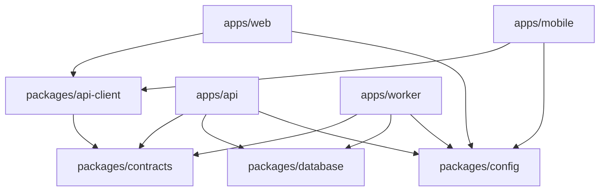

# Monorepo structure

## Approved target layout

```text
apps/
  web/                 Next.js browser application
  api/                 NestJS HTTP, webhook, and Socket.IO process
  worker/              NestJS application context and BullMQ processors
  mobile/              Expo / React Native application
packages/
  database/            Prisma schema, migrations, generated client wrapper
  contracts/           Runtime schemas, DTOs, event and error contracts
  api-client/          Typed transport used by web and mobile
  config/              Environment-agnostic constants and feature metadata
  eslint-config/       Shared lint configuration
  typescript-config/   Shared strict TypeScript bases
infra/
  docker/              Local-only infrastructure support files
docs/
pnpm-workspace.yaml
package.json
pnpm-lock.yaml
compose.yaml
```

`packages/config` must not contain secrets or server-only environment values. Create additional shared packages only after two real consumers exist. UI components should not be shared between web and native prematurely because their rendering and accessibility primitives differ.

## Dependency boundaries



- Only API and worker may import `packages/database`, provider SDKs, secret loaders, or privileged tokens.
- `contracts` contains transport-safe runtime validation and types, not authorization or business logic.
- `api-client` handles transport, auth refresh coordination, idempotency headers, cursor pagination, and normalized errors. It contains no tenant trust decisions.
- Domain rules live in server application/domain modules and are reused by API handlers and workers through server-local libraries or modules, not copied into clients.
- The worker does not expose public HTTP business endpoints. It may expose restricted health/metrics endpoints depending on hosting.

## API modular boundaries

Suggested NestJS modules are `Auth`, `Users`, `Organizations`, `Memberships`, `Invitations`, `Authorization`, `ChannelConnections`, `Contacts`, `Inbox`, `Assignments`, `Messaging`, `Comments`, `Webhooks`, `Attachments`, `Notifications`, `Analytics`, `Audit`, `Realtime`, `Outbox`, and `Billing`. Keep modules in one deployable API until measured scaling or ownership needs justify extraction.

## Workspace standards for Milestone 2

- Private root package and workspace globs `apps/*` and `packages/*`.
- Pin `packageManager` and all direct dependencies; commit one pnpm lockfile.
- Use strict TypeScript, consistent module semantics, formatter/editor settings, linting, unit-test configuration, and CI scripts.
- Each app must start, build, lint, typecheck, and test independently. Root scripts aggregate without hiding failures.
- Database generation/migration commands are explicit; application startup never silently migrates production.
- Environment schemas fail fast and distinguish build-time public configuration from runtime secrets.
- Compose provisions only project-scoped local services. Omit fixed `container_name`; use configurable host ports due to the existing stopped `postgres` container documented in Milestone 0.

## Version compatibility decision

The Milestone 0 verified baseline (2026-10-12) recommends Node 22.17.1, pnpm 10.34.7, Next.js 16.4.0, NestJS 12.1.3, Prisma 7.10.0, PostgreSQL 18, Redis 8.10.0, BullMQ 6.3.13, Socket.IO 4.8.4, and Expo 57 with its managed React Native version. These are proposed pins, not installed dependencies or permanent architectural requirements.

Milestone 2 must re-query official framework/package metadata immediately before scaffolding because these versions can change. Keep Prisma CLI/client aligned, Nest core packages compatible, Socket.IO client/server compatible, and React/React Native versions selected by the Expo and Next scaffolds. Any change is documented with engine and peer-dependency evidence. Do not adopt a release candidate by default.

## Build and release discipline

CI should restore from the lockfile, validate generated artifacts, lint, typecheck, test, build, scan for secrets/dependency risks, and publish immutable artifacts. Database migrations are a separately authorized deployment step with backups and rollback/forward-fix instructions. Web/API/worker/mobile versions should expose a compatible API contract version; mobile releases require backward-compatible server evolution because installed clients cannot update instantly.

