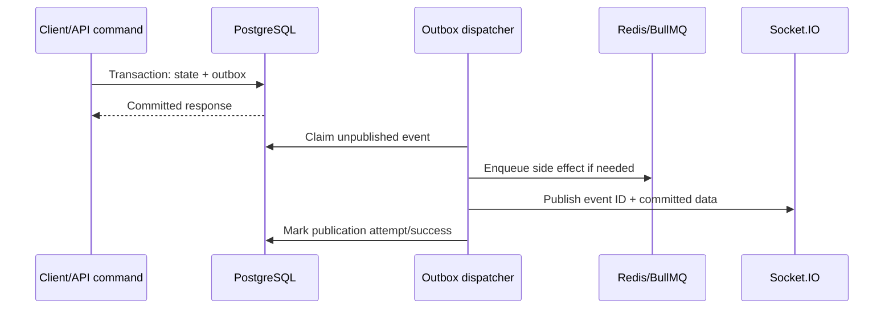

# Realtime and queue architecture

## Responsibilities

- PostgreSQL holds authoritative state, idempotency records, and the transactional outbox.
- BullMQ/Redis schedules background work and retries; a lost Redis dataset must not erase authoritative business state.
- Socket.IO delivers low-latency hints/updates after commit; REST cursor sync recovers truth.
- API processes accept/authorize commands and provider webhooks. Worker processes execute side effects and projections.

## Persist before publish

Every user-visible mutation writes domain state and an `OutboxEvent` in one PostgreSQL transaction. An outbox dispatcher claims unpublished rows with concurrency-safe locking, emits to Socket.IO or enqueues downstream work, then records publication. A crash may cause repeat publication, so consumers deduplicate by globally unique `eventId`; a crash must never produce an event for rolled-back state.

External sends follow the same principle: persist the outbound intent first, then queue by internal message ID after commit/outbox dispatch. Workers never trust full client-supplied message/job payloads.



## Queue catalog

Initial logical queues (physical consolidation is acceptable at small scale):

| Queue | Work | Key controls |
| --- | --- | --- |
| `webhook-ingest` | Normalize recorded provider events | event-row ID jobs; dedupe; per-account ordering where needed |
| `outbound-send` | Send messages/comment replies | provider/account rate limiting; idempotency; ambiguity reconciliation |
| `media` | Fetch, scan, transform, expire attachments | private storage; SSRF/size/type controls; low concurrency |
| `notifications` | In-app and later push delivery | preferences; safe payload; per-recipient dedupe |
| `analytics` | Rebuild/reconcile aggregates | source cursor/version; restartable ranges |
| `outbox` | Publish committed events/jobs | database polling/notification; repeat-safe |
| `maintenance` | retention, token health, reconciliation | leader election, bounded batches, audited actions |

Jobs have versioned schemas, internal IDs, correlation IDs, attempt limits, exponential backoff/jitter, timeout/stall policy, and classified retry rules. Exhausted jobs go to a retained failure/dead-letter state with alerts and an authorized replay runbook. Never place provider tokens or unnecessary content in Redis/job payloads.

## Socket authentication and rooms

Socket handshake uses a current short-lived access credential. Server resolves active user/session and membership; authorization is repeated for room joins and sensitive events. Recommended rooms:

- `org:{organizationId}` for organization-scoped summary events.
- `member:{membershipId}` for private assignments/notifications.
- `conversation:{conversationId}` and `comment-thread:{id}` only after tenant/resource authorization.

Room names are server-generated. Clients request subscriptions by resource ID; they never provide trusted room strings. On organization switch, revoke old subscriptions and reconnect/re-authenticate. Membership/role/session revocation triggers disconnect or room eviction within a documented maximum interval.

Clients do not send authoritative state over arbitrary socket events. Business mutations use authenticated HTTP commands initially (or explicitly validated socket commands later); sockets primarily carry server events.

## Event envelope and synchronization

```json
{
  "eventId": "uuid",
  "sequence": "opaque-org-cursor",
  "organizationId": "uuid",
  "type": "message.created",
  "version": 1,
  "aggregate": { "type": "conversation", "id": "uuid", "version": 7 },
  "occurredAt": "ISO-8601",
  "data": {}
}
```

Event types include message created/status, conversation/comment updated, assignment changed, resolution changed, read state changed, comment created/updated/deleted, and notification created. Payloads contain the least data needed and never secrets.

Client keeps a bounded event-ID dedupe store and last acknowledged organization sync cursor. On initial load/reconnect/background resume it calls incremental sync; if the cursor is expired, it performs a paginated full refresh. Aggregate versions prevent stale events from overwriting newer state. Socket ordering is not assumed across rooms/processes.

## Scaling and operations

Use the maintained Socket.IO Redis adapter when multiple API instances are deployed. Redis requires authentication/TLS/network restriction in hosted environments. BullMQ worker concurrency is tuned by provider/account and workload. Metrics include queue depth/age, failures/retries, stalled jobs, outbox lag, webhook receipt-to-visible latency, socket connections/auth denials, reconnects, and sync fallback rates.

## Required tests

Test commit-before-event, rollback silence, duplicate outbox publication, duplicate jobs/webhooks, worker crash/retry, provider timeout ambiguity, dead-letter replay, stale/out-of-order event handling, unauthorized room joins, tenant switch, membership revocation, multi-instance fan-out, reconnect cursor sync, expired cursor full refresh, and optimistic HTTP/socket deduplication.

