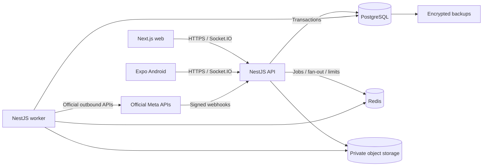
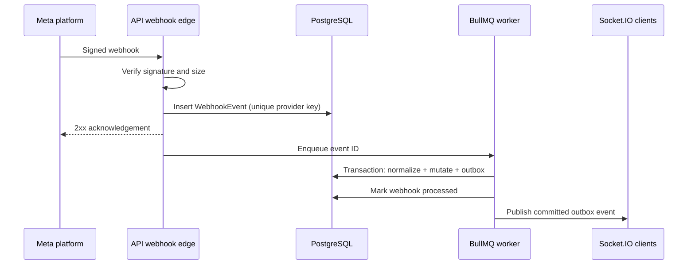

# System overview

## Purpose and scope

This document set is the Milestone 1 design baseline for a commercial multi-tenant unified inbox. It guides Milestones 2-20; it does not create application code, infrastructure, integrations, or credentials.

The system serves four internal roles (Super Admin, Organization Admin, Supervisor, and Moderator) and normalizes customer interactions from Facebook Messenger, Instagram Direct Messages, WhatsApp Cloud API, Facebook comments, and Instagram comments. Web and Android clients use the same NestJS API and PostgreSQL source of truth.

## Architectural style

Start as a modular monolith with independently runnable processes:

- Next.js web client for browser workflows.
- NestJS API for HTTP, authentication, authorization, business rules, webhooks, and Socket.IO.
- NestJS worker process for BullMQ jobs.
- Expo/React Native Android client using the same public API contracts.
- PostgreSQL for authoritative transactional data.
- Redis for BullMQ, distributed rate-limit/state primitives, and Socket.IO fan-out; Redis data is reconstructable and not authoritative.
- Private object storage for attachments in hosted environments. Local development may use an explicitly non-production emulator selected later.

Domain modules remain inside the API and worker codebases: identity/access, organizations, inbox, assignments, messages, comments, channel connections, webhooks, notifications, analytics, audit, and billing placeholders. Modules communicate through explicit application services and persisted outbox events. They are not premature network microservices.

## Core data and trust boundaries

1. A client authenticates as a user; the server resolves the active organization from a validated route/header claim and an active membership. Clients never grant themselves roles or tenant access.
2. Every tenant-owned row carries `organization_id`. Service/repository methods require an organization context, and composite constraints prevent related rows from crossing organizations.
3. Inbound webhooks are authenticated using the provider's current signature/challenge rules, recorded idempotently, acknowledged quickly, and processed asynchronously.
4. Inbound/outbound provider payloads are normalized into separate conversation/message or social-comment models while retaining scoped provider identifiers and limited diagnostic metadata.
5. A database transaction persists business state and an outbox record. Only after commit may a worker publish a real-time event or execute an external side effect.
6. Each conversation has nullable `current_assignee_membership_id`; null is the explicit unassigned state. Immutable assignment events retain history. Message author, assignee-at-send, and completion recipient are separate facts.

## Principal workflows

### Inbound interaction

### Outbound reply

The authenticated membership is the reply author. In one transaction the API validates permissions and channel policy, creates a message in `QUEUED`, snapshots the current assignee, writes audit/outbox data, and commits. A worker sends through the selected adapter using an idempotency key where supported, updates provider identifiers/status, and emits committed status events. Replying never changes assignment.

## Quality attributes

- **Isolation:** fail closed when tenant context is absent; test cross-tenant ID substitution at API, queue, socket, and file boundaries.
- **Reliability:** transactional state transitions, outbox delivery, idempotent consumers, bounded retries, dead-letter review, and reconciliation jobs.
- **Auditability:** append-only assignment, completion, privileged action, and integration lifecycle records; timestamps are stored in UTC.
- **Security:** least privilege, validation at ingress and job boundaries, server-held secrets, private media, redacted logs, and secure defaults from the foundation milestones.
- **Operability:** structured logs with correlation IDs, health/readiness endpoints, queue lag/error metrics, alerts, backup/restore exercises, and documented runbooks.
- **Evolvability:** stable versioned contracts and provider adapters isolate product code from external API changes.

## Deployment units and environments

Development, test, staging, and production are isolated environments with separate databases, Redis instances, storage, secrets, callback URLs, and Meta assets where available. Deploy web, API, and worker as separate units from one monorepo. The API/Socket.IO hosting must support long-lived connections; workers must run persistently. Production topology is selected in Milestone 19.

## Testing strategy by layer

- Unit tests: policies, transition rules, normalization, analytics calculations, adapters.
- Database integration tests: constraints, tenant-scoped repositories, transactions, idempotency, concurrency.
- API/socket tests: authentication, permissions, cross-tenant denial, event authorization, recovery.
- Contract tests: mock adapters and shared client/API schemas.
- End-to-end tests: web and mobile critical workflows against isolated test infrastructure.
- Authorized staging tests: actual platform behavior only after credentials and approvals exist.

## Assumptions and limitations

- An individual user may belong to multiple organizations; the active organization is explicit per request/session context.
- Roles are organization-scoped except `SUPER_ADMIN`, which is a platform-level privilege and is always explicitly checked and audited.
- Initial content is plain text plus supported attachments; rich content is allowlisted per channel capability.
- Provider support, permissions, message windows, retention, and API versions are verified against current official documentation during Milestones 8 and 11-13.
- Billing records are modeled now only to avoid schema dead ends. Provider selection and enforcement wait for Milestone 19 approval.

