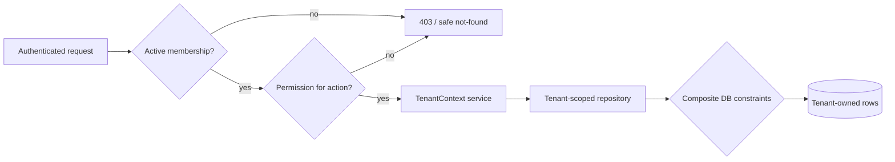

# Tenant isolation

## Security invariant

No user, process, job, socket, export, upload, log query, or provider event may read or mutate one organization's data while operating for another organization. UI filtering is never an isolation control.

## Request context

After authentication, the API resolves an explicit organization identifier from the route (preferred for tenant resources) or a documented header. A guard loads the active `Membership` by `(user_id, organization_id, status=ACTIVE)`. It then creates an immutable request context containing user ID, organization ID, membership ID, role/permissions, session ID, correlation ID, and authentication strength.

The client may request an organization but cannot supply a trusted membership, role, author ID, or tenant filter. Platform Super Admin endpoints use a separate namespace and explicit platform authorization; they do not bypass repository scoping invisibly.

## Enforcement layers

1. **Transport:** authentication, organization context, membership, and permission guards execute before controllers/gateways.
2. **Application services:** each use case receives `TenantContext`; service signatures do not accept optional organization scoping for tenant operations.
3. **Repositories:** tenant-owned queries include organization ID. Fetch-by-ID helpers require `(organizationId,id)` rather than globally fetching then checking.
4. **Database:** every owned row has `organization_id`; composite foreign keys prevent cross-tenant relations; uniqueness is scoped appropriately.
5. **Async jobs:** payloads contain resource IDs and claimed organization ID but workers reload the record and validate the relationship. Job input is untrusted and schema-validated.
6. **Realtime:** the server derives room authorization from current membership/resource ownership; clients cannot join arbitrary tenant or conversation rooms.
7. **Files:** opaque storage keys, private buckets, tenant-aware metadata lookup, short-lived signed downloads after authorization, and no user-controlled bucket paths.
8. **Caching/search/metrics:** tenant ID is part of every key/document/label lookup boundary; sensitive tenant IDs are controlled to avoid high-cardinality telemetry leaks.

Use a consistent safe error policy: unauthenticated is `401`; authenticated but unauthorized actions are `403`; tenant-scoped object lookup may return `404` to avoid confirming another tenant's identifier. Logs retain the internal denial reason without exposing it to clients.

## Membership and tenant switching

- A user can have multiple memberships, but a request has exactly one active organization context.
- Switching organizations means selecting another active membership and refetching permissions/data; cached pages, sockets, and optimistic state from the prior tenant are cleared.
- Suspension/removal invalidates or version-checks sessions and socket authorization promptly. Permission-sensitive operations re-check current membership server-side, not only token claims.
- Invitations are scoped to one organization and cannot be accepted into another through parameter substitution.

## Database session and RLS decision

Primary enforcement is application/repository scoping plus composite database constraints. PostgreSQL Row Level Security is recommended for evaluation as defense in depth during Milestones 3-4, but is not declared enabled until transaction pooling behavior is proven.

Safe RLS requires a least-privilege application role that cannot bypass policies; transaction-local tenant context (`SET LOCAL` or equivalent); every query within that transaction; no leaked context through pooled connections; explicit handling for platform jobs/migrations; policies for every owned table; and positive/negative integration tests. If Prisma/driver transaction semantics cannot guarantee these invariants, document the exception and retain the other controls rather than deploy misleading RLS.

## High-risk boundaries and required tests

| Boundary | Required negative test |
| --- | --- |
| REST/GraphQL-like resource lookup | Tenant A ID submitted in Tenant B route/header is denied without data disclosure |
| Nested writes | Cross-tenant contact, assignee, attachment, message, post, or parent IDs fail |
| Lists/search/exports | Every result belongs to the active organization, including empty/filter edge cases |
| Socket rooms/events | Tenant B cannot join, receive, infer, or publish Tenant A events |
| Queue jobs | Forged/mismatched organization and resource IDs fail and are audited/dead-lettered |
| Files | Object key/attachment ID substitution cannot produce upload/download access |
| Idempotency/cache | Same client key in two tenants cannot collide or reveal responses |
| Analytics | Aggregates and leaderboard membership remain organization-scoped |
| Super Admin | Ordinary roles cannot reach platform endpoints; privileged reads/actions are audited |
| Deactivated membership | Existing session/socket loses tenant access within the documented revocation window |

## Review checklist for every tenant-owned feature

- Identify owner organization and authorization permission.
- Require server-derived `TenantContext` at entry and repository layers.
- Add `organization_id`, composite relationships, tenant-first indexes, and scoped uniqueness.
- Validate related memberships/resources are active and in the same organization.
- Scope idempotency, caches, queues, object storage, notifications, audit logs, and realtime events.
- Add ID-substitution and role-denial tests before calling the feature complete.

