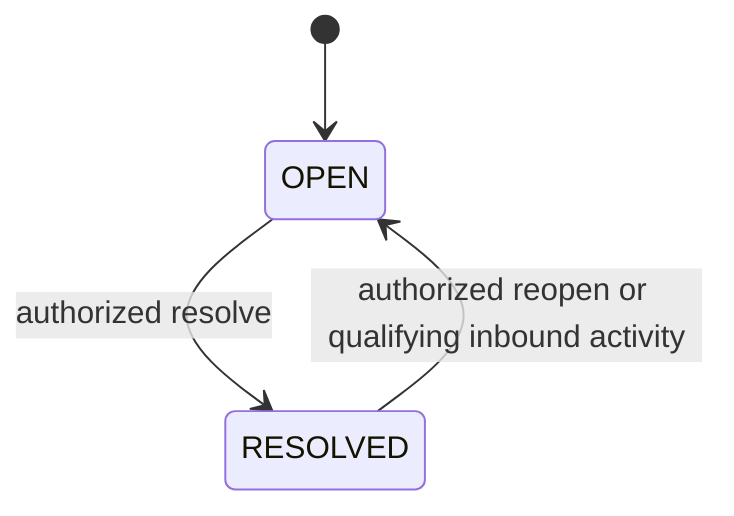

# Unified inbox architecture

## Product model

The inbox presents two related item types behind one stable API contract:

- `DIRECT_MESSAGE`: a `Conversation` with ordered `Message` records.
- `COMMENT_THREAD`: a social post/comment root with `SocialComment` and reply records.

They remain separate persistence models because threading, edit/delete semantics, visibility, reply windows, delivery states, and moderation capabilities differ. An inbox summary discriminated by `itemType` provides common fields: stable internal ID, organization/channel, contact/author summary, preview, activity time, unread state, workflow status, current assignee, supported actions, and channel-specific metadata.

## List, filters, and search

The server supports `All`, `Direct Messages`, and `Comments`, plus channel/account, assignee (including unassigned/me), open/resolved, unread, and time filters. Cursor pagination uses a deterministic tuple such as `(last_activity_at,id)` and opaque signed/encoded cursors. It must not use offset pagination for actively changing inbox lists.

Start search with tenant-scoped PostgreSQL capabilities across safe normalized fields and message/comment content according to retention policy. Exact-match provider/customer identifiers are scoped by connected account. Add a search service only after measured PostgreSQL limits; any later index is a derived tenant-scoped projection, not the source of truth.

## State model

- “Reopened” is an append-only resolution event, while the current projection returns to `OPEN`.
- New inbound activity updates `last_activity_at` and unread projections transactionally. Automatic reopen behavior is a versioned policy and records its source.
- Read state is per membership; it does not alter another moderator's state. Organization-level “needs response” should be a separate derived field, not inferred from one user's read flag.
- Assignment is independent of workflow status and reply authorship.

## Message/reply flow

1. Client sends validated content, attachment references, and a unique client idempotency key; never an authoritative author or assignee-at-send.
2. API authorizes the active membership and checks current channel capabilities/policy windows.
3. Transaction creates a `QUEUED` outbound record with authenticated author, immutable display snapshot, current assignee snapshot, audit/outbox records, and idempotency response.
4. Worker sends via the adapter, applying provider rate/retry constraints.
5. Committed status updates are `QUEUED`, `SENDING`, `SENT`, `DELIVERED`, `READ`, or `FAILED` only when evidence supports them. Unsupported states remain absent; API acceptance is not provider delivery.
6. Client reconciles HTTP and Socket.IO updates by stable internal message/event IDs.

Provider state may arrive out of order. Status application follows channel-specific monotonic/terminal rules while retaining raw status events for audit and reconciliation.

## Attachments

Clients request an authorized upload intent, upload to private storage, and finalize metadata. The server validates size, declared type, magic bytes, extension, ownership, and state; generates opaque names; strips unsafe metadata where required; and queues malware scanning where appropriate. A reply may reference only finalized clean attachments in the same tenant/session policy. Downloads proxy or use short-lived signed URLs after authorization. Provider media retrieval uses bounded size/time, validated destinations, and SSRF protections.

## Concurrency and consistency

- Use optimistic versioning or row locks for assignment, resolve/reopen, and relevant state transitions.
- Idempotency keys prevent duplicate outbound creation; adapter/provider idempotency is used when available.
- Persist the authoritative mutation plus outbox event before broadcasting.
- A monotonically ordered organization sync cursor/event sequence permits clients to recover missed updates. Socket events are accelerators, not the only synchronization path.
- UI optimistic records use client IDs and reconcile to server IDs; receiving both HTTP response and socket event must produce one item.

## API surface guidance

Suggested versioned resources: inbox summaries, DM conversations/messages, comment threads/replies, assignments, resolution actions, read states, attachment intents, channel capabilities, and incremental sync. Mutation DTOs are runtime-validated. Responses use normalized error codes, request IDs, server timestamps, and capability flags so clients do not guess platform behavior.

## Required tests

Cover stable cursor pagination under concurrent inserts; all filter combinations; cross-tenant and role denial; separate comments/DM serialization; per-user unread behavior; resolve/reopen history; reassignment races; duplicate reply submission; unsupported attachments/capabilities; provider failure/status ordering; optimistic/socket deduplication; and safe search authorization.

